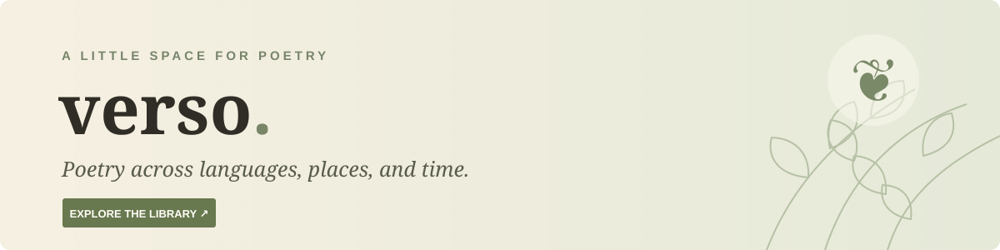

# Verso Poetry Library 📖🌿

[](https://dmoliveira.github.io/ai-poems/)

[](https://github.com/dmoliveira/ai-poems/actions/workflows/pages.yml)
[](https://dmoliveira.github.io/ai-poems/)
[](https://dmoliveira.github.io/ai-poems/#explore)
[](https://dmoliveira.github.io/ai-poems/#explore)
[](LICENSE)
[](https://buy.stripe.com/8x200i8bSgVe3Vl3g8bfO00)

**[Visit Verso →](https://dmoliveira.github.io/ai-poems/)** · [Explore poems](https://dmoliveira.github.io/ai-poems/#explore) · [Contribute](CONTRIBUTING.md) · [Support the project 💛](https://buy.stripe.com/8x200i8bSgVe3Vl3g8bfO00)

Verso is a free, cozy, multilingual poetry library for discovering classic poetry in its original language, learning about authors and literary history, and following a thread from one poem to another. The `ai-poems` repository builds a static website for GitHub Pages: no account or server is required.

## A little room for discovery ✨

- **Read:** 1,022 poems in English, Spanish, Portuguese, French, Italian, Chinese, Japanese, and Arabic, from more than 150 named or traditional author groups.
- **Explore:** browse associated countries and regions with flags and poem counts, or search poem text, titles and poets. Choose a preferred reading language and optionally find poems available in it, including originals and translations. Filter by poet, original language, collection, form, transcribed line count, available translation, place and dated year. A work associated with multiple places is counted under each; an associated place is not necessarily where it was written. Results rotate through languages and poets, and “Surprise me” picks from the current results. Share or return to a search using its link, or continue through its results from the reader. Theme tags cover only part of the catalogue.
- **Understand:** source and rights notes, author, era, place, collection, and context. Linked, sourced relationships are distinguished from same-author and shared-theme suggestions.
- **Make it yours:** save poems, revisit reading history, choose a light, sepia or dark theme, switch between literary serif and clear sans verse, adjust text size, or use distraction-free focus mode. Fonts are hosted locally, with system fallbacks for scripts they do not cover. These preferences stay in your browser's local storage; clearing a shelf or history asks for confirmation.
- **Read across languages:** original and translation views, side-by-side reading, preserved line breaks, language tags and right-to-left Arabic support. If your preferred language has a translation, it appears alongside the original; otherwise the original remains available with a clear note. Reader pages load only the data they need rather than downloading the full catalogue. Poem cards and reading rooms take on a subtle palette suited to each work's mood.
- **Discoverable:** every poem has a static, readable URL, a descriptive title and metadata, canonical and social tags, structured data, and an entry in the sitemap.
- **Follow updates:** subscribe to the [RSS feed](https://dmoliveira.github.io/ai-poems/feed.xml) for selected, dated additions and updates. The feed is editorially maintained and does not claim to list every past addition.

### An honest note about coverage

Coverage remains uneven: the collection includes 320 Chinese and 548 English works, three in Italian, and one original each in Japanese and Arabic. It includes the 154 Shakespeare sonnets and 281 Dickinson poems in early edited editions. More poets, countries, modern work, historical context and independently reviewed translations are planned. **Not every poem is available in every language.** The interface is currently in English.

The seven non-original language versions of Li Bai's *Quiet Night Thought* are explicitly labelled **AI-assisted, unreviewed reading aids**, not attributed to historical translators. Bashō's English version is separately attributed to Lafcadio Hearn; four Baudelaire poems include F. P. Sturm's English translations from a 1919 edition. Two Leopardi poems include Frederick Townsend's 1887 translations of later textual versions, marked where they differ from the 1826 originals. Other translations are shown only when included and identified. See [rights and sources](docs/rights-and-sources.md) and the [roadmap](docs/roadmap.md).

## Run locally 🛠️

Requires Node.js 20 or newer. No backend or API keys are needed.

```sh
npm ci
npm test
npm run build
npm run serve
```

Open **http://127.0.0.1:4173/ai-poems/**. The path matches the GitHub Pages project path. For browser tests, install Chromium once with `npx playwright install chromium`, then run `npm run test:browser`. To use an existing Chrome installation, set `CHROME_PATH` to its executable.

The GitHub Actions workflow tests and builds pull requests, then publishes `_site/` to GitHub Pages when `main` changes. Static poem pages and the complete index remain readable with JavaScript disabled; interactive search and the shelf require JavaScript.

The sitemap is published at [`/ai-poems/sitemap.xml`](https://dmoliveira.github.io/ai-poems/sitemap.xml) and can be submitted to search-engine webmaster tools. Search engines decide whether and when to index pages. Because this is a project site under a path, crawlers normally consult `robots.txt` at the **domain root**; the generated project-level `robots.txt` does not control that root.

## Adding poems and translations 🌍

Curated records live in [`content/curated.mjs`](content/curated.mjs); the independently sourced Shakespeare sequence is in [`content/shakespeare-sonnets.json`](content/shakespeare-sonnets.json). Add more individual records or batches as JSON files in [`content/poems/`](content/poems/). The site is generated by [`scripts/build.mjs`](scripts/build.mjs). See [CONTRIBUTING.md](CONTRIBUTING.md) before adding a record, especially for text, translation, copyright, dates and evidence of influence. Content is not automatically translated or imported at runtime.

The launch sonnets can be reproduced from [Project Gutenberg eBook 1041](https://www.gutenberg.org/ebooks/1041): download its UTF-8 plain text and run `node scripts/import-sonnets.mjs /path/to/pg1041.txt`. The importer verifies the sequence and the two historically unusual line counts. Source files, checksums, import commands and edition caveats for the expanded collections are in [rights and sources](docs/rights-and-sources.md). Review diffs against the source before committing.

## More from the same maker 🌱

[](https://dmoliveira.github.io/master-philosophers/)
[](https://dmoliveira.github.io/learn-spanish-immersion/)

- [Master Philosophers 🧠](https://dmoliveira.github.io/master-philosophers/) · [repository](https://github.com/dmoliveira/master-philosophers)
- [Learn Spanish Immersion 🇪🇸](https://dmoliveira.github.io/learn-spanish-immersion/) · [repository](https://github.com/dmoliveira/learn-spanish-immersion)

## Privacy, credits and licensing

Verso uses local storage for bookmarks, recent reading and display preferences, and session storage to continue a search within the same browser tab; no account or cookies are required. The site includes no analytics code or remote font requests. GitHub Pages and any external site you choose to visit have their own policies. Clearing browser storage removes local shelf data.

The application code is [MIT licensed](LICENSE). Poem texts, transcriptions, translations and artwork are **not automatically covered by the code license**; see the individual source and rights notes and [rights and sources](docs/rights-and-sources.md). Copyright and public-domain rules vary by country. The garden hero is an AI-generated illustration created for Verso. Cormorant Garamond and DM Sans are distributed under their included SIL Open Font Licenses.
